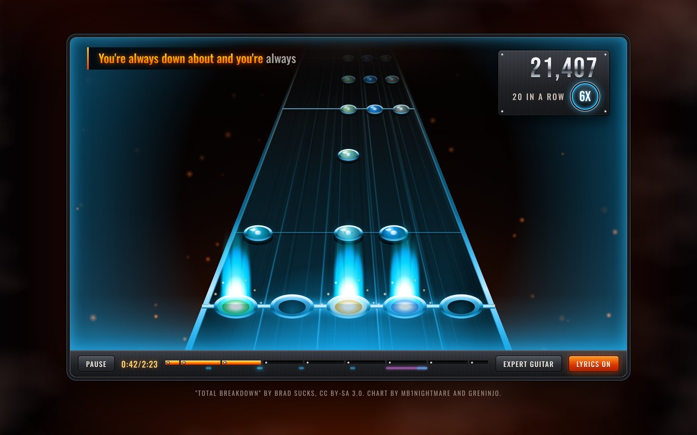
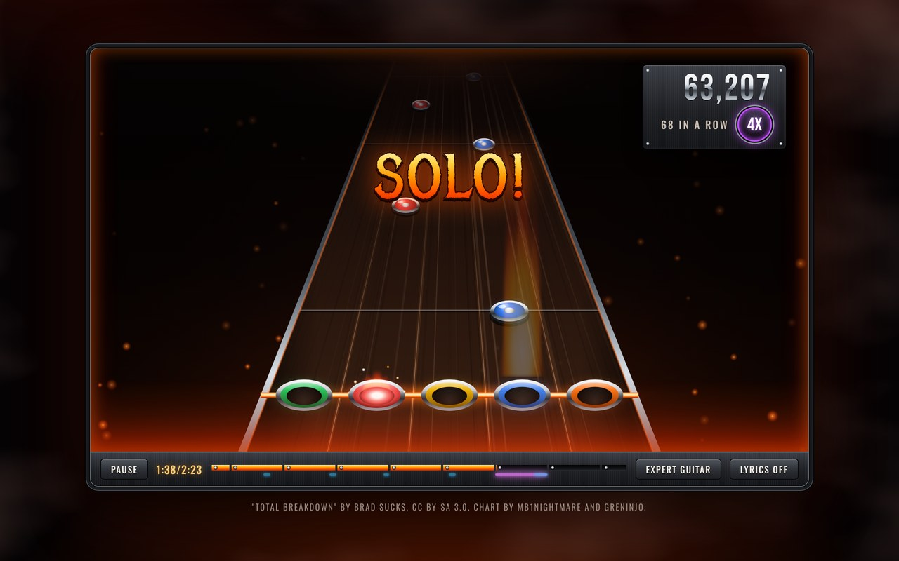
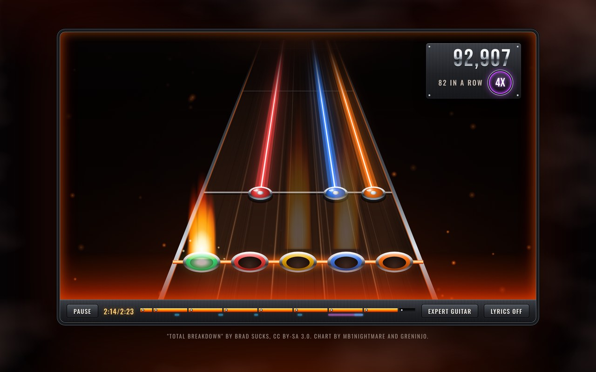
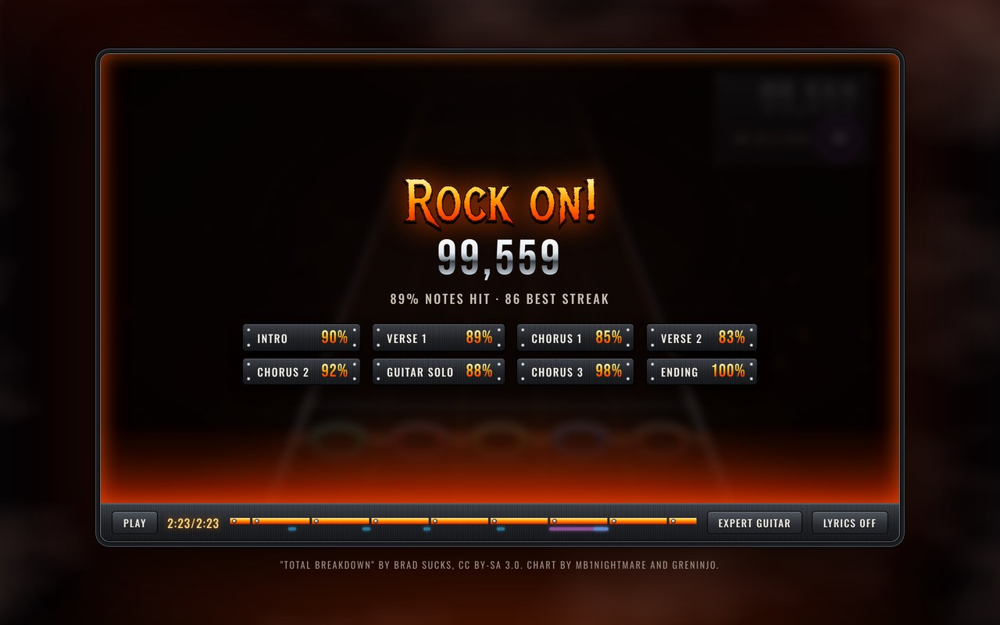

# Video.js Hero

Play it at [videojs-hero.vercel.app](https://videojs-hero.vercel.app).

A tiny Guitar Hero inside a [Video.js](https://videojs.org) React player, built on its timed metadata APIs. It's the
example app for a blog post about timed metadata: the game reads every note, sustain, Star Power phrase, solo, section,
and lyric as text track cues, and is mostly a few hooks that react to cues entering and leaving. (The highway itself is
drawn from the media's own copy of the notes.)



## Quick start

```bash
pnpm install
pnpm song   # download the chart and audio into public/song/
pnpm dev
```

Behind a proxy, Node's `fetch` needs to be told about it:

```bash
NODE_USE_ENV_PROXY=1 NODE_EXTRA_CA_CERTS=/path/to/ca.crt pnpm song
```

(`NODE_EXTRA_CA_CERTS` is only needed when the proxy intercepts TLS.) The download is kept as `.cache/chart.sng`, so
later runs skip it.

Other scripts: `pnpm build`, `pnpm preview`, `pnpm typecheck`.

## Controls

- Keys **1** to **5** strum the five lanes, green to orange. You can also tap the lanes at the strike line, or play a
  [guitar controller](#guitar-controllers).
- The part menu (bottom right) picks the instrument and difficulty.
- Lyrics are on by default and light up syllable by syllable; toggle them with the **Lyrics** button.

## Guitar controllers

A Guitar Hero guitar works through the browser's Gamepad API (`src/use-guitar.ts`). Like the real game, holding frets
does nothing until you strum: a strum, up or down, plays every fret held, so chords work, and letting go of a fret ends
its sustain. A strum with no fret held is ignored rather than counted as an overstrum. Press a button on the guitar
after the page loads, and a "Guitar connected" note shows.

- The fret and strum mapping is the `GUITAR_BUTTONS` table at the top of `src/use-guitar.ts`. It fits guitars the
  browser reports with the `standard` mapping: Xbox 360 (XInput) guitars, Santroller, and the CRKD Nitro in XInput
  mode.
- PS3, Wii, and other HID guitars report their own layouts, so they need a table of their own (and the `standard` check
  in `useGuitar` loosened). Open the page with `?pads` (for example `http://localhost:5173/?pads`) to see each connected
  gamepad's id, mapping, held buttons, and pushed axes, then press each fret and the strum bar to read their numbers.
- Browsers only offer gamepads to `https` pages and `localhost`.

## How it works

- **The chart is the media.** `src/chart-media.ts` is a custom media that the player drives like a `<video>`: it
  plays the song's Web Audio stems and draws the highway on a canvas (`src/highway.ts`). `src/chart-media-view.tsx`
  plugs it into the player.
- **Parts are renditions.** Each instrument at each difficulty is one of the media's renditions, so the player's
  quality menu becomes the part picker.
- **Misses are an audio track.** A missed note selects the `missed` audio track, which mutes the part's stem until the
  next hit selects `hit` again.
- **The chart is text tracks.** The interesting files:
  - [`src/tracks.ts`](src/tracks.ts) defines a typed text track per layer of the chart, and turns a notes file into cues
    that span each note's hit window and each sustain's tail.
  - [`src/song-tracks.ts`](src/song-tracks.ts) adds those tracks to the player, swapping in the notes, Star Power, and
    solos of whichever part is picked.
  - [`src/use-cue-events.ts`](src/use-cue-events.ts) turns a track's active cues into `onEnter` and `onExit` calls.
  - [`src/use-game.ts`](src/use-game.ts) is the game: a strum hits a note whose cue is active, a note cue that exits
    unhit is a miss, holding a hit note through its sustain's cue earns a bonus, and solo cues show a banner.
- `scripts/fetch-song.ts` downloads the Clone Hero chart, reads its MIDI, and writes the manifest, per-part notes, and
  cue files the page loads from `/song/`.

**The chart format.** A Clone Hero song is a folder of audio stems plus a chart (`notes.mid` or `notes.chart`, here
packed into one `.sng` file). The chart holds the notes for each instrument and difficulty, Star Power and solo phrases,
the song's sections, and its lyrics. `pnpm song` turns those into plain cue lists. The
[chart format docs](https://github.com/TheNathannator/GuitarGame_ChartFormats) have the details for the curious.

**Timing.** The custom media fires `timeupdate` every animation frame, so cues turn active and inactive at most a frame
late. A real `<video>` fires it about four times a second, which is fine for captions and chapters but too coarse to call
a miss, so hits are judged against `currentTime` at the moment of the keypress.

What we bumped into in Video.js along the way is in [`docs/findings.md`](docs/findings.md).







## Video.js version

The timed metadata APIs are on Video.js `main` but not yet in an npm release. Until they ship, the `@videojs/*`
dependencies are pinned to a [pkg.pr.new](https://pkg.pr.new) build of `main` at commit `da33ee1`.

## Credits and licensing

- **Music:** "Total Breakdown" by Brad Sucks, from
  [Out Of It](https://freemusicarchive.org/music/Brad_Sucks/Out_Of_It/), licensed
  [CC BY-SA 3.0](https://creativecommons.org/licenses/by-sa/3.0/).
- **Chart:** by MB1Nightmare and Greninjo. It is **not** redistributed in this repository: `pnpm song` downloads it
  into the gitignored `public/song/`. Permission to redistribute it is pending.
- Screenshots in `docs/` show the song and chart above.
